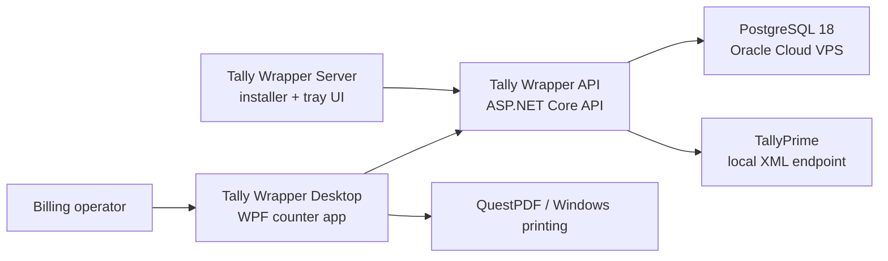

# Tally Wrapper

[](https://dotnet.microsoft.com/)
[](https://www.microsoft.com/windows)
[](https://www.postgresql.org/)
[](https://learn.microsoft.com/dotnet/desktop/wpf/)
[](https://tallysolutions.com/)

Tally Wrapper is a Windows billing system for jewellery showrooms. It combines a WPF counter app, one ASP.NET Core API on the showroom's Tally server, PostgreSQL, QuestPDF printing, and direct TallyPrime XML integration.

The system is designed for operator-controlled billing. Bills are saved through the API, printed from the desktop app, and pushed to Tally only when an operator explicitly clicks a push action. There is no background Tally polling, queue worker, or automatic posting loop.

## Contents

- [What It Does](#what-it-does)
- [Architecture](#architecture)
- [Repository Layout](#repository-layout)
- [Prerequisites](#prerequisites)
- [Quick Start](#quick-start)
- [Configuration](#configuration)
- [Running Locally](#running-locally)
- [Publishing EXEs](#publishing-exes)
- [Server Deployment](#server-deployment)
- [Security Model](#security-model)
- [Testing](#testing)
- [Troubleshooting](#troubleshooting)
- [Documentation](#documentation)

## What It Does

Tally Wrapper supports the core workflow for a jewellery billing counter:

| Area | Capabilities |
|---|---|
| Billing | Draft creation, invoice numbering, jewellery line math, GST-inclusive totals, edit/revise/void flows |
| Tally | Synchronous voucher create/alter, master refresh, active company checks, failure reporting |
| Printing | Tax invoice preview, PDF export, printer dispatch, logo/signature/watermark assets, structured print layout designer |
| Operations | Health banners, startup recovery, server installer and tray, logs, database setup from the tray |
| Admin | Passcode unlock, session tokens, editing posted bills, bill renumbering, local state overrides, destructive actions |
| Multi-counter | Tally-server API service with trusted LAN workstations |

## Architecture

The app is intentionally split into a small number of clear runtime pieces:



### Runtime Shape

There is one topology. The API runs as a Windows Service on the Tally server, installed by the server EXE. Every counter's Desktop is a client of that API over the LAN; a Desktop never starts or carries an API. The only connection setting a workstation holds is the server's address (Settings → Server).

The API owns all durable business state. The Desktop is a rich client; it does not maintain a separate local billing database, and it shows a limited-mode screen while the server cannot be reached.

### Tally Integration Contract

Tally communication is synchronous and operator-initiated:

- Save Bill creates/updates the bill in PostgreSQL only.
- Push / Retry / Repost sends one voucher HTTP request to Tally and returns `posted`, a definite `failed`, or `reconciliation_required` when the write outcome is uncertain.
- Refresh from Tally fetches masters on demand and writes the snapshot.
- If the API crashes while a bill is in `posting`, startup recovery moves it to `reconciliation_required`; the operator verifies Tally before marking it posted or pending.

See [docs/05_tally_integration_contract.md](docs/05_tally_integration_contract.md) for the full contract.

## Repository Layout

```text
src/
  ShowroomBilling.Api/          ASP.NET Core API, auth, controllers, runtime setup
  ShowroomBilling.Desktop/      WPF desktop app, view models, views
  ShowroomBilling.ServerTray/   Server installer and tray controller for the API service
  ShowroomBilling.Application/  Application contracts and business services
  ShowroomBilling.Infrastructure/ EF Core, PostgreSQL, Tally XML, persistence workflows
  ShowroomBilling.Contracts/    Shared DTOs between API and desktop
  ShowroomBilling.Printing/     QuestPDF invoice rendering

tests/
  ShowroomBilling.Tests/         API, infrastructure, contracts, printing tests
  ShowroomBilling.Desktop.Tests/ ViewModel and desktop workflow tests

tools/
  publish-prod.ps1                  Desktop EXE
  publish-server-tray.ps1           server installer / tray EXE (carries the API)
  uninstall-server-api-service.ps1  removes what the server EXE installs
  run-scratch.ps1                   dev build on a throwaway database with a stand-in Tally
  Test-Coverage.ps1                 runs the tests and enforces the coverage floor

docs/
  Architecture, API, database, deployment, printing, settings, and UI references
```

## Prerequisites

Development currently targets Windows because the desktop host is WPF.

| Requirement | Notes |
|---|---|
| Windows 10/11 | Required for WPF, printing, DPAPI, and Windows Service/server tray behavior |
| .NET SDK `10.0.202` | Pinned by [global.json](global.json) |
| PostgreSQL 18 | The production database. Development and the tests use throwaway PostgreSQL 18 containers |
| Docker | Starts those containers for `tools\run-scratch.ps1` and for the database tests (a local engine, or a remote Docker context) |
| `dotnet-ef` | Installed globally (`dotnet tool install --global dotnet-ef`); applies migrations |
| TallyPrime | Required for real posting and master refresh workflows |
| PowerShell | Required for the scripts in `tools\` |

Optional:

- VS Code with the checked-in launch/tasks configuration.

## Quick Start

Clone and build:

```powershell
git clone <repo-url>
cd tally-wrapper

dotnet restore ShowroomBilling.sln
dotnet build ShowroomBilling.sln
dotnet test --solution ShowroomBilling.sln
```

The tests that touch the database start their own PostgreSQL 18 container, so `dotnet test` needs Docker; see [Testing](#testing).

Run the dev build on a throwaway database with a stand-in Tally:

```powershell
.\tools\run-scratch.ps1
```

It starts a `postgres:18` container, migrates it, starts the API on `127.0.0.1:5108` and then the Desktop, both with empty settings folders, so the run cannot reach the saved production connection, the real server or TallyPrime. Details and options are in [DEV_SETUP.md](DEV_SETUP.md#run-against-a-scratch-database). A plain `dotnet run` or F5 (see [Running Locally](#running-locally)) uses whatever this PC has saved: the API its database connection, the Desktop its server address.

Development API defaults to:

- OpenAPI document: `http://localhost:5108/openapi/v1.json`
- Liveness: `http://localhost:5108/api/health/live`
- Runtime health: `http://localhost:5108/api/runtime/health`

## Configuration

### Database Connection

Real connection strings are not committed. Keep them in one of these private locations:

- OpenBao KV v2 at `kv/Postgres/apps/tally_wrapper/prod` (canonical production secret; authoritative structured fields plus a synchronized `connection_string`)
- OpenBao KV v2 at `kv/Postgres/apps/tally_wrapper_test/dev`, key `connection_string` (persistent Coolify test environment)
- `src/ShowroomBilling.Api/appsettings.Development.json`
- `src/ShowroomBilling.Api/appsettings.Production.json`
- user secrets
- local environment variables (`SHOWROOM_BILLING_POSTGRES` is the API's explicit database override)
- the DPAPI-protected database override the server tray writes (`database.<Environment>.local.json` in the API's data folder)

A connection string is always in the Npgsql keyword form; a `postgres://` URL is refused. The committed `src/ShowroomBilling.Api/appsettings.json` holds only a placeholder:

```text
Host=localhost;Port=5432;Database=tally_wrapper;Username=postgres;Password=postgres
```

Production uses PostgreSQL 18 hosted on an Oracle Cloud Infrastructure VPS. The OpenBao secret at `kv/Postgres/apps/tally_wrapper/prod` is the source of truth: its structured connection fields are authoritative and `connection_string` is the synchronized Npgsql form used for runtime injection and EF migrations. The application does not read OpenBao directly; an authorized operator retrieves the derived value with the native `bao` CLI and supplies it through the server tray or another private runtime configuration source. Never commit the credential. See [PostgreSQL deployment](docs/11_deployment_and_ops.md#4-postgresql-deployment) for the OpenBao workflow and the network, TLS, backup, and maintenance responsibilities of the self-hosted database.

The persistent test deployment uses `tally_wrapper_test` inside the same Coolify `shared-postgres` PostgreSQL 18 cluster and connects through PgBouncer; it is not a separate database server. Its OpenBao path, network attachment, and role contract are documented in [Development Setup](DEV_SETUP.md#shared-persistent-test-database).

Migrations are applied with `dotnet ef database update`. Always pass `--connection`; do not rely on environment-name resolution. On production they are applied by hand before a new build is started. The full command is in [Deployment and operations](docs/11_deployment_and_ops.md#openbao-production-secret) and the production procedure in its [§11](docs/11_deployment_and_ops.md#11-upgrade-flow).

### Database Identity Marker

The app uses a DB-owned identity marker to catch accidental environment mixups: `DEV` or `PROD` in `public.database_identity`. The SQL that sets it is in [DEV_SETUP.md](DEV_SETUP.md#database). The Desktop status bar displays `DB DEV`, `DB PROD`, `DB UNSET`, or a mismatch warning.

### Tally Connection

Tally host, port, active company, ledgers, voucher types, and stock mappings are backend-owned settings. Operators configure them through the Desktop Settings screen. Tally calls are made by the API process, so TallyPrime must be reachable from the machine the API runs on (the Tally server).

## Running Locally

The Desktop is a client: it needs an API that is already running and never starts one. With nothing listening at its address it opens on the limited-mode screen.

### Scratch run

```powershell
.\tools\run-scratch.ps1
```

This is the way to run the dev build on any PC that also runs the real app. It starts a throwaway PostgreSQL 18 container and a stand-in Tally on port 9000, starts the API on `127.0.0.1:5108`, then the Desktop, and stops the API when the app closes. See [DEV_SETUP.md](DEV_SETUP.md#run-against-a-scratch-database).

### VS Code

The repository includes VS Code launch/tasks files:

- [`.vscode/launch.json`](.vscode/launch.json)
- [`.vscode/tasks.json`](.vscode/tasks.json)

Recommended debug target:

```text
Desktop + API
```

This builds the solution, then starts the API in Development mode on `127.0.0.1:5108` and the Desktop. The `Desktop` configuration alone needs an API you started yourself.

### By hand

Start the API first:

```powershell
$env:ASPNETCORE_ENVIRONMENT = "Development"
$env:DOTNET_ENVIRONMENT = "Development"
dotnet run --project src/ShowroomBilling.Api --urls http://127.0.0.1:5108
```

Then the Desktop, in a second terminal:

```powershell
$env:DOTNET_ENVIRONMENT = "Development"
dotnet run --project src/ShowroomBilling.Desktop
```

F5 and `dotnet run` read this PC's real settings folder. The API uses whatever database connection this PC has configured (see [Database Connection](#database-connection)), and a Desktop started by `dotnet run` on a PC with a server address saved in Settings → Server uses that address in place of `http://localhost:5108`, so it talks to the real server. Set `SHOWROOM_DESKTOP_DesktopBootstrap__ApiBaseUrl` for the session to point it at the development API; the VS Code `Desktop` launch configuration already does.

## Publishing EXEs

The publish scripts create self-contained Windows artifacts under `publish/`.

### Desktop Production EXE

```powershell
.\tools\publish-prod.ps1
```

Output:

```text
publish\prod\TallyWrapper.exe
```

The artifact is the Desktop alone: it contains no API and no database settings. Copy it to each counter PC.

### Server Installer / Tray EXE

```powershell
.\tools\publish-server-tray.ps1
```

Output:

```text
publish\server\TallyWrapper.Server.exe
```

This one-file EXE carries the API service binary and installs/repairs the API Windows Service.

## Server Deployment

One server PC runs TallyPrime and the Tally Wrapper API; every counter connects to it.

1. Publish the server installer:

   ```powershell
   .\tools\publish-server-tray.ps1
   ```

2. Copy `publish\server\TallyWrapper.Server.exe` to the Tally server.

3. Run it on the Tally server.

4. On first run, enter the trusted LAN CIDR for billing workstations, for example:

   ```text
   192.168.1.0/24
   ```

5. The installer:

   - extracts the API service binary to `C:\ProgramData\ShowroomBilling\bin`
   - installs the Tally Wrapper API Windows Service
   - configures the service for `http://0.0.0.0:5107`
   - creates a firewall rule scoped to the trusted LAN CIDR
   - creates `C:\ProgramData\ShowroomBilling\maintenance_token.txt`
   - registers the tray companion at user login
   - starts the API service

6. On the server PC, set the database connection in the tray dashboard, under **Database connection**: paste it, **Test**, **Save**, then **Restart** on the Windows service line.

7. On each workstation, open:

   ```text
   Billing -> Settings -> Server
   ```

8. Enter the server address, or click **Find server** to scan the workstation's own network for it:

   ```text
   http://<tally-server>:5107
   ```

9. Check it with **Test server**, then click **Save and restart Billing**.

The server tray dashboard can install/repair, start/stop/restart the API service, test/save database settings, open logs, show connected clients, and copy the workstation URL. It is the only place the server's database connection is changed. Exiting the tray stops the API service first.

To remove the server, exit the tray and run this elevated, signed in as the user whose tray starts at sign-in:

```powershell
.\tools\uninstall-server-api-service.ps1
```

It removes the Windows Service, the firewall rule and the tray's start-up entry. `C:\ProgramData\ShowroomBilling` (saved database connection, maintenance token, logs, API binary) is kept unless you add `-RemoveConfig`.

## Security Model

This project is built for a trusted showroom LAN, not internet exposure.

| Layer | Behavior |
|---|---|
| Trusted LAN | The server install accepts workstation writes from the configured CIDRs, with a firewall rule of the same scope; workstations send no token |
| Device token | A development API (default `LocalFile` mode) requires `X-Device-Token` on mutating calls: a random secret in a local file that the API and a Desktop on the same PC both read. The Desktop sends it only to a loopback address |
| Admin token | Admin-only actions require `X-Admin-Token`, issued after passcode unlock and expiring after 30 minutes |
| Maintenance token | Server tray DB maintenance uses a localhost-only `X-Maintenance-Token` file under server app data |
| Database secrets | Only the API holds a connection string. The one the tray saves is DPAPI-protected on the server PC; production credentials are not committed, and the Desktop artifact contains none |
| Read endpoints | Business read endpoints are intentionally unauthenticated for the trusted LAN deployment model |

Important deployment notes:

- Do not expose the Tally Wrapper API directly to the internet.
- Keep the trusted CIDR as narrow as practical.
- On the server install the first admin passcode can be set only from the server PC itself (loopback).
- The database maintenance endpoints (test, save) and the connected-clients list answer loopback callers only.
- Keep real `appsettings.Development.json` and `appsettings.Production.json` ignored and local.
- Do not publish or zip `bin/`, `obj/`, `publish/`, `.env`, logs, or local appsettings files.

## Testing

Run the full suite:

```powershell
dotnet test --solution ShowroomBilling.sln
```

Run formatting, warning, dependency, and coverage gates:

```powershell
dotnet list ShowroomBilling.sln package --vulnerable --include-transitive
dotnet format style ShowroomBilling.sln --verify-no-changes --no-restore
dotnet build ShowroomBilling.sln --configuration Release --no-restore -warnaserror
.\tools\Test-Coverage.ps1 -NoBuild
```

Run API contract tests only:

```powershell
dotnet test --project tests/ShowroomBilling.Tests/ShowroomBilling.Tests.csproj --filter "FullyQualifiedName~Contracts"
```

The tests that touch the database run on PostgreSQL 18 and start it themselves, so the full suite needs Docker (a local engine, or a remote Docker context the `docker` command can reach) or `SHOWROOM_BILLING_POSTGRES_TEST_CONNECTION` pointing at a PostgreSQL 18 server. See [Development Setup](DEV_SETUP.md#database-tests). To run only the tests that need no database:

```powershell
dotnet test --project tests/ShowroomBilling.Tests/ShowroomBilling.Tests.csproj --filter "Category!=Postgres"
```

What the tests cover:

- bill state workflows
- numbering/idempotency shape
- admin unlock behavior
- API contract shape
- Tally XML voucher generation
- database configuration masking and the tray's maintenance endpoints
- WPF ViewModel workflows
- printing/rendering helpers

Every database-backed test runs on PostgreSQL 18, matching production: each test gets its own freshly migrated database, so locking, unique indexes, set-based updates and real races are exercised rather than approximated. CI runs these tests on Linux (the container cannot run on a Windows runner) and the rest on Windows, then judges their coverage together.

The persistent `tally_wrapper_test` deployment database is not the connection for this harness: the fixture requires permission to create and drop `tw_test_<guid>` databases, while the persistent API role is intentionally restricted to its one PgBouncer mapping. See [Development Setup](DEV_SETUP.md#shared-persistent-test-database).

## Troubleshooting

| Symptom | Likely Cause | Fix |
|---|---|---|
| Build fails copying Desktop DLLs | Desktop EXE is still running | Close `TallyWrapper.exe` / the Desktop process and rebuild |
| API starts but DB is not ready | Missing or invalid Postgres connection string | Set the connection from the server tray, then restart the API service |
| Desktop opens in limited mode ("Working without the server") | The server is off or unreachable, or the saved server address is wrong | Click **Server Settings**, use **Test server** or **Find server**, then **Save and restart Billing**; check that the API service is running on the server |
| Tally push is blocked, fails, or needs reconciliation | TallyPrime closed, wrong company open, business XML rejection, or the write response was lost | Preflight blocks leave state unchanged; definite rejections can be retried after correction. For `reconciliation_required`, verify the voucher in Tally and use admin Mark as Pushed or Mark as Pending before another push. |
| Workstation cannot reach server | Firewall/CIDR/API URL mismatch | Re-run server installer and verify `http://<server>:5107/api/health/live` |
| Admin action returns 401 | Admin token expired or not unlocked | Press `~` in Desktop and unlock again |
| Server tray DB save fails | Maintenance token missing or API not running locally | Choose **Repair installation…** in the tray dashboard |

## Documentation

The detailed specs live in [docs/](docs/README.md):

- [Bill state machine](docs/03_bill_state_machine.md)
- [Numbering and idempotency](docs/04_numbering_and_idempotency.md)
- [Tally integration contract](docs/05_tally_integration_contract.md)
- [Tally XML golden path](docs/06_tally_xml_golden_path.md)
- [Printing spec](docs/07_printing_spec.md)
- [Settings: where they are defined and edited](docs/08_settings_catalog.md)
- [API spec](docs/09_api_spec.md)
- [Database schema](docs/10_database_schema.md)
- [Deployment and operations](docs/11_deployment_and_ops.md)
- [Settings storage contract](docs/14_settings_storage_contract.md)
- [UI design reference](docs/15_ui_design_reference.md)
- [Synthetic batch data](docs/17_synthetic_batch.md)

## Public Repo Hygiene

Before making a fork or release public:

```powershell
gitleaks detect --source . --redact
git status --ignored --short
```

Expected private local files include ignored API environment settings. They should never be committed:

```text
src/ShowroomBilling.Api/appsettings.Development.json
src/ShowroomBilling.Api/appsettings.Production.json
```

The publish output under `publish/` is intentionally ignored.

## License

No open-source license file is currently included. Add a `LICENSE` file before accepting external use or contributions.
