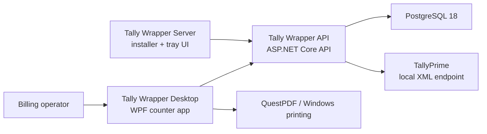

# Tally Wrapper

[](https://dotnet.microsoft.com/)
[](https://www.microsoft.com/windows)
[](https://www.postgresql.org/)
[](https://learn.microsoft.com/dotnet/desktop/wpf/)
[](https://tallysolutions.com/)

Tally Wrapper is a Windows billing system for jewellery showrooms. It combines a WPF counter app, one ASP.NET Core API on the showroom's Tally server, PostgreSQL, QuestPDF printing, and direct TallyPrime XML integration.

Saving records the bill in PostgreSQL. Operators can print from the Desktop and explicitly push the voucher to Tally. The API also reads Tally for health checks, master refreshes and voucher lookups.

## Contents

- [What It Does](#what-it-does)
- [Architecture](#architecture)
- [Repository Layout](#repository-layout)
- [Quick Start](#quick-start)
- [Publishing EXEs](#publishing-exes)
- [Server Deployment](#server-deployment)
- [Security Model](#security-model)
- [Testing](#testing)
- [Troubleshooting](#troubleshooting)
- [Documentation](#documentation)

## What It Does

Tally Wrapper supports the core workflow for a jewellery billing counter:

| Area | Capabilities |
|---|---|
| Billing | Draft creation, invoice numbering, jewellery line math, GST-inclusive totals, edit/revise/void flows |
| Tally | Synchronous voucher create/alter, master refresh, active company checks, failure reporting |
| Printing | Tax invoice preview, PDF export, printer dispatch, logo/signature/watermark assets, structured print layout designer |
| Operations | Health banners, startup recovery, server installer and tray, logs, database setup from the tray |
| Admin | Passcode unlock, session tokens, editing posted bills, bill renumbering, local state overrides, destructive actions |
| Multi-counter | Tally-server API service with trusted LAN workstations |

## Architecture

The app is intentionally split into a small number of clear runtime pieces:



### Runtime Shape

There is one topology. The API runs as a Windows Service on the Tally server, installed by the server EXE. Every counter's Desktop is a client of that API over the LAN; a Desktop never starts or carries an API. The only connection setting a workstation holds is the server's address (Settings → Server).

The API owns all durable business state. The Desktop is a rich client; it does not maintain a separate local billing database, and it shows a limited-mode screen while the server cannot be reached.

### Tally Integration Contract

The API handles each posting request synchronously.

- Save Bill creates/updates the bill in PostgreSQL only.
- Push / Retry / Repost sends one voucher HTTP request to Tally and returns `posted`, a definite `failed`, or `reconciliation_required` when the write outcome is uncertain.
- Refresh from Tally fetches masters on demand and writes the snapshot.
- If the API crashes while a bill is in `posting`, startup recovery moves it to `reconciliation_required`; the operator verifies Tally before marking it posted or pending.

See [docs/05_tally_integration_contract.md](docs/05_tally_integration_contract.md) for the full contract.

## Repository Layout

```text
src/
  ShowroomBilling.Api/          ASP.NET Core API, auth, controllers, runtime setup
  ShowroomBilling.Desktop/      WPF desktop app, view models, views
  ShowroomBilling.ServerTray/   Server installer and tray controller for the API service
  ShowroomBilling.Application/  Application contracts and business services
  ShowroomBilling.Infrastructure/ EF Core, PostgreSQL, Tally XML, persistence workflows
  ShowroomBilling.Contracts/    Shared DTOs between API and desktop
  ShowroomBilling.Printing/     QuestPDF invoice rendering

tests/
  ShowroomBilling.Tests/         API, infrastructure, contracts, printing tests
  ShowroomBilling.Desktop.Tests/ ViewModel and desktop workflow tests

tools/
  publish-prod.ps1                  Desktop EXE
  publish-server-tray.ps1           server installer / tray EXE (carries the API)
  uninstall-server-api-service.ps1  removes what the server EXE installs
  run-scratch.ps1                   dev build on a throwaway database with a stand-in Tally
  Test-Coverage.ps1                 runs the tests and enforces the coverage floor

docs/
  Architecture, API, database, deployment, printing, settings, and UI references
```

## Quick Start

For a local run on Windows, install the .NET 10 SDK, PowerShell 7, Docker and the matching EF Core tools. From the repository root, run this in PowerShell 7.

```powershell
.\tools\run-scratch.ps1
```

The script prepares a throwaway PostgreSQL 18 database and starts the API, a stand-in Tally and the Desktop. For prerequisites, build commands, debugger setup and scratch reset or removal, see the [development setup guide](DEV_SETUP.md). For an installed showroom server, see [deployment and operations](docs/11_deployment_and_ops.md).

## Publishing EXEs

The publish scripts create self-contained Windows artifacts under `publish/`.

### Desktop Production EXE

```powershell
.\tools\publish-prod.ps1
```

Output:

```text
publish\prod\TallyWrapper.exe
```

The artifact is the Desktop alone: it contains no API and no database settings. Copy it to each counter PC.

### Server Installer / Tray EXE

```powershell
.\tools\publish-server-tray.ps1
```

Output:

```text
publish\server\TallyWrapper.Server.exe
```

This one-file EXE carries the API service binary and installs/repairs the API Windows Service.

## Server Deployment

One server PC runs TallyPrime and the Tally Wrapper API; every counter connects to it. In short: publish `TallyWrapper.Server.exe`, run it on the Tally server, give it the trusted LAN range, set the database connection in its tray dashboard, then enter the server's address on each workstation under **Settings → Server**.

The steps, what the install puts on the server, upgrading, going back and removing it are in [Deployment and operations](docs/11_deployment_and_ops.md): [§3 Server install](docs/11_deployment_and_ops.md#server-install), [§5 Server tray](docs/11_deployment_and_ops.md#5-server-tray), [§2 Server address](docs/11_deployment_and_ops.md#server-address) for the workstations, and [§11](docs/11_deployment_and_ops.md#11-upgrade-flow) for an upgrade.

## Security Model

This project is built for a trusted showroom LAN, not internet exposure.

| Layer | Behavior |
|---|---|
| Trusted LAN | The server install accepts workstation writes from the configured CIDRs, with a firewall rule of the same scope; workstations send no token |
| Device token | A development API (default `LocalFile` mode) requires `X-Device-Token` on mutating calls: a random secret in a local file that the API and a Desktop on the same PC both read. The Desktop sends it only to a loopback address |
| Admin token | Admin-only actions require `X-Admin-Token`, issued after passcode unlock and expiring after 30 minutes |
| Maintenance token | Server tray DB maintenance uses a localhost-only `X-Maintenance-Token` file under server app data |
| Database secrets | Only the API holds a connection string. The one the tray saves is DPAPI-protected on the server PC; production credentials are not committed, and the Desktop artifact contains none |
| Read endpoints | Business read endpoints are intentionally unauthenticated for the trusted LAN deployment model |

Important deployment notes:

- Do not expose the Tally Wrapper API directly to the internet.
- Keep the trusted CIDR as narrow as practical.
- On the server install the first admin passcode can be set only from the server PC itself (loopback).
- The database maintenance endpoints (test, save) and the connected-clients list answer loopback callers only.
- Keep real `appsettings.Development.json` and `appsettings.Production.json` ignored and local.
- Do not publish or zip `bin/`, `obj/`, `publish/`, `.env`, logs, or local appsettings files.

## Testing

Run `dotnet test --solution ShowroomBilling.sln` for the full suite. The [test setup](DEV_SETUP.md#database-tests) describes PostgreSQL requirements, test filters and the CI checks.

## Troubleshooting

| Symptom | Likely Cause | Fix |
|---|---|---|
| Build fails copying Desktop DLLs | Desktop EXE is still running | Close `TallyWrapper.exe` / the Desktop process and rebuild |
| API starts but DB is not ready | Missing or invalid Postgres connection string | Set the connection from the server tray, then restart the API service |
| Desktop shows “Billing is paused” | The billing server is unreachable, its database is down, or a database upgrade is pending | Read the banner for the cause. For an unreachable server, check its API service and the address in **Server settings**. For a database problem, check the connection or pending migrations on the server PC. |
| Tally push is blocked, fails, or needs reconciliation | TallyPrime closed, wrong company open, business XML rejection, or the write response was lost | Preflight blocks leave state unchanged; definite rejections can be retried after correction. For `reconciliation_required`, verify the voucher in Tally and use admin Mark as Pushed or Mark as Pending before another push. |
| Workstation cannot reach server | Firewall/CIDR/API URL mismatch | Re-run server installer and verify `http://<server>:5107/api/health/live` |
| Admin action returns 401 | Admin token expired or not unlocked | Press `~` in Desktop and unlock again |
| Server tray DB save fails | Maintenance token missing or API not running locally | Choose **Repair installation…** in the tray dashboard |

## Documentation

The detailed specs live in [docs/](docs/README.md):

- [Bill state machine](docs/03_bill_state_machine.md)
- [Numbering and idempotency](docs/04_numbering_and_idempotency.md)
- [Tally integration contract](docs/05_tally_integration_contract.md)
- [Tally XML golden path](docs/06_tally_xml_golden_path.md)
- [Printing spec](docs/07_printing_spec.md)
- [Settings: where they are defined and edited](docs/08_settings_catalog.md)
- [API spec](docs/09_api_spec.md)
- [Database schema](docs/10_database_schema.md)
- [Deployment and operations](docs/11_deployment_and_ops.md)
- [Settings storage contract](docs/14_settings_storage_contract.md)
- [UI design reference](docs/15_ui_design_reference.md)
- [Synthetic batch data](docs/17_synthetic_batch.md)
- [Bill hand-over from another program](docs/18_bill_handover.md)

## Public Repo Hygiene

Keep site-specific hosts, roles, secret-store paths and recovery contacts in the deployment’s private runbook. Before making a fork or release public, check the repository.

```powershell
gitleaks detect --source . --redact
git status --ignored --short
```

Expected private local files include ignored API environment settings. They should never be committed:

```text
src/ShowroomBilling.Api/appsettings.Development.json
src/ShowroomBilling.Api/appsettings.Production.json
```

The publish output under `publish/` is intentionally ignored.

## License

No open-source license file is currently included. Add a `LICENSE` file before accepting external use or contributions.
